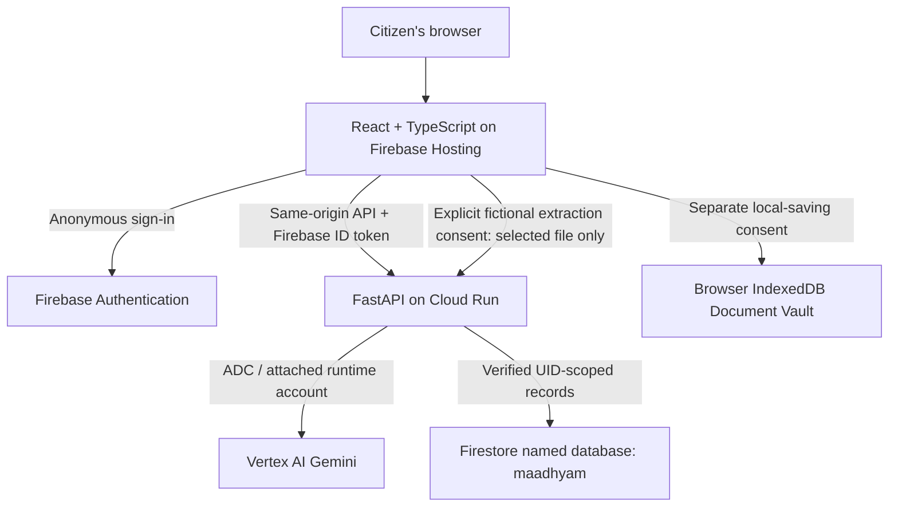

# Maadhyam (माध्यम)

**AI-powered citizen assistance for navigating Indian government services**
**Google AI Builder Cup 2026 · Working prototype**

[Live prototype](https://maadhyam-1610.web.app) · [QA evidence](qa/evidence/after-firebase-fix/execution.json) · [QA documentation](qa/README.md)

## Problem and solution

Citizens navigating government services may encounter differing document requirements, inconsistent names, dates of birth or addresses, and uncertainty about which correction to make first. **Maadhyam** combines document intelligence, explainable rule evaluation and dependency-aware planning to help citizens prepare before visiting official government channels.

> **Independent prototype:** Maadhyam is not an official government portal. It does not issue documents, submit government applications, or guarantee eligibility, acceptance or approval.

## Capabilities

| Area | What the application does |
|---|---|
| Document Vault | Upload PDF/PNG/JPEG samples, edit metadata, mark records self-reviewed and optionally persist files in browser-local IndexedDB. |
| Gemini extraction | Explicitly consent to processing one fictional document through FastAPI and Vertex AI; review validated proposed fields before applying. |
| Identity comparison | Compare Indian name variations, birth dates and addresses; inspect provisional or missing values and discrepancies. A flag does not establish which record is correct. |
| Passport Guided Journey | Choose an assistance type, select a named household applicant or Other, answer questions and inspect source-linked document guidance. |
| Rules-as-Code and checklists | Apply deterministic preparation rules and evidence categories; distinguish supporting-document candidates from verified official acceptance. |
| Household Intelligence | Organize members using unique IDs, confirm document-owner associations, retain distinct people with the same relationship, and inspect prerequisite graphs and cycles. Relationships remain unverified. |
| Resolution Planner | Turn findings and prerequisites into next steps; review target-date urgency, document expiry, blockers and dependent tasks. |
| Advanced reasoning | Explore deadlocks, proof-substitution candidates, what-if corrections, identity/name evolution, address continuity, minimum review sets and weighted paths. Example time/cost estimates are not government commitments. |
| Citizen workflows | Human assistance, life-event discovery, multi-department guidance, rejection diagnosis, legacy-record recovery, authority bottlenecks, deadline rescue and visit-reduction planning. These provide preparation guidance, not official system integrations. |
| AI assistant | Preserve the floating assistant for local evidence-based guidance or optional Gemini explanations using explicitly confirmed fictional metadata. |
| Cloud preparations | Consent to saving Passport answers, applicant details, selected document IDs and household/planner progress under a verified Firebase anonymous UID; refresh and resume the same record. File bytes are not stored in Firestore. |

**Scope:** Passport is the primary guided prototype journey. Other catalogue entries or advanced workflows may be informational, simulated or marked *Coming Soon*. Planning outputs are not official government determinations.

## Live demo

**https://maadhyam-1610.web.app**

1. Explore the citizen service catalogue and open the Passport preparation journey.
2. Where supported, upload **fictional** documents from [`demo/fictional_documents/`](demo/fictional_documents/).
3. Review extracted information, potential discrepancies and explanatory guidance.
4. Explore available correction planning, prerequisites and what-if scenarios.
5. Review preparation tasks and the AI assistance interface, where configured.

**Privacy:** Review the sample PDFs before public release to ensure no real personal identifiers are present. Do not use real identity documents in the public demo.

## Architecture



| Layer | Technology |
| --- | --- |
| Frontend | React, TypeScript, Vite |
| Backend | Python, FastAPI |
| AI | Google Gemini / Vertex AI integration |
| Hosting | Firebase Hosting and Google Cloud Run |
| Cloud services | Firebase Authentication and configured Google Cloud / Firebase services |
| Validation | Pytest, automated browser tests, HTTP tests, frontend lint/build and regression suites |

## Repository structure

```text
Maadhyam-prototype/
├── Maadhyam/
│   ├── apps/
│   │   ├── api/             # FastAPI backend
│   │   └── web/             # React + TypeScript frontend
│   ├── firebase.json
│   └── package.json
├── demo/
│   └── fictional_documents/
├── qa/
│   ├── run_final.py
│   ├── README.md
│   └── evidence/
│       └── after-firebase-fix/
└── README.md
```

## Local development

Prerequisites: compatible Node.js/npm, Python and [uv](https://docs.astral.sh/uv/). Cloud-backed workflows require authorized environment configuration.

**Backend** — from repository root:

```bash
cd Maadhyam/apps/api
uv sync --extra dev
uv run --extra dev python -m uvicorn maadhyam_api.main:app --app-dir src --reload --port 8000
```

API docs: `http://127.0.0.1:8000/docs`.

**Frontend** — in another terminal, from repository root:

```bash
cd Maadhyam/apps/web
npm ci
npm run dev
```

Use the URL printed by Vite. Never commit `.env`, `.env.local`, credentials or service-account keys.

## Quality assurance

**Final local validation: 18 October 2026. All 11 QA execution stages passed.**

| Validation | Verified outcome |
| --- | --- |
| Backend tests | **463 passed** |
| Browser tests | **284 passed** |
| Frontend lint | Passed |
| Frontend production build | Passed |
| Test collection | Passed |
| HTTP tests | Passed |
| Legacy functional suite | Passed |
| Legacy reasoning suite | Passed |
| Legacy M9 suite | Passed |
| Legacy vault suite | Passed |
| Legacy smoke suite | Passed |

**747 backend and browser tests passed.** Other suites are listed separately to avoid double-counting.

### Inspect the evidence

- [Consolidated execution summary](qa/evidence/after-firebase-fix/execution.json)
- [Backend log](qa/evidence/after-firebase-fix/backend.log) · [Backend JUnit XML](qa/evidence/after-firebase-fix/backend.xml)
- [Browser log](qa/evidence/after-firebase-fix/browser.log) · [Browser JUnit XML](qa/evidence/after-firebase-fix/browser.xml)
- [Frontend build log](qa/evidence/after-firebase-fix/frontend-build.log) · [Frontend lint log](qa/evidence/after-firebase-fix/frontend-lint.log)
- [QA documentation](qa/README.md)

To reproduce after installing dependencies, from repository root:

```bash
MAADHYAM_FINAL_QA_OUTPUT=qa/evidence/local-run \
  Maadhyam/apps/api/.venv/bin/python qa/run_final.py
```

Browser tests require supported browser automation dependencies and frontend test configuration. The successful run used local services with **live providers disabled** (`"liveProviders": false`); it is not a production load-test or government integration certification.

## Deployment references

- [Google Cloud deployment guide](qa/MAADHYAM_MANUAL_GOOGLE_CLOUD_DEPLOYMENT_GUIDE.md)
- [Manual cloud deployment handoff](qa/M12_1_MANUAL_CLOUD_DEPLOYMENT_HANDOFF.md)
- [Deployment and smoke-test report](qa/FINAL_DEPLOYMENT_AND_SMOKE_TEST_REPORT.md)

Review cloud permissions, billing, credentials and storage access before deployment.

## Fictional citizen walkthrough

1. Open the live application in a browser profile you can retain.
2. Add fictional household members, including two distinct people with the same relationship.
3. Upload fictional supporting documents to Document Vault.
4. Assign exact document holders and confirm permission for associations.
5. Review printed metadata and inspect potential name, DOB or address differences.
6. Start a Passport preparation from My Preparations or Services.
7. Select a household applicant, or choose Other and enter a fictional custom name.
8. Answer the questionnaire and inspect the document checklist and source-linked guidance.
9. Open Resolution Planner; change the personal target date and inspect dependencies and recommended actions.
10. Use Save preparation and explicitly consent to cloud storage. Household cloud saving also has a confirmation.
11. Refresh and resume the same record; enable separate Vault local-saving consent if the files should survive a refresh on this device.
12. Try the floating assistant. Only enable Gemini for fictional metadata; extraction separately requires fictional-file transmission consent.

## Responsible use and limitations

- Official government portals and authorities remain the source of truth.
- AI-extracted information and recommendations may be inaccurate and need human review.
- Correction routes, durations and costs may be illustrative.
- Do not upload genuine identity documents to a public demonstration.
- Maadhyam does not submit government applications or guarantee outcomes.

## Team

Swarada Jalukar · Shreyas Chaudhari · Darshana Ranalkar · Aditya Phadke

---

*Built for the Google AI Builder Cup 2026.*
